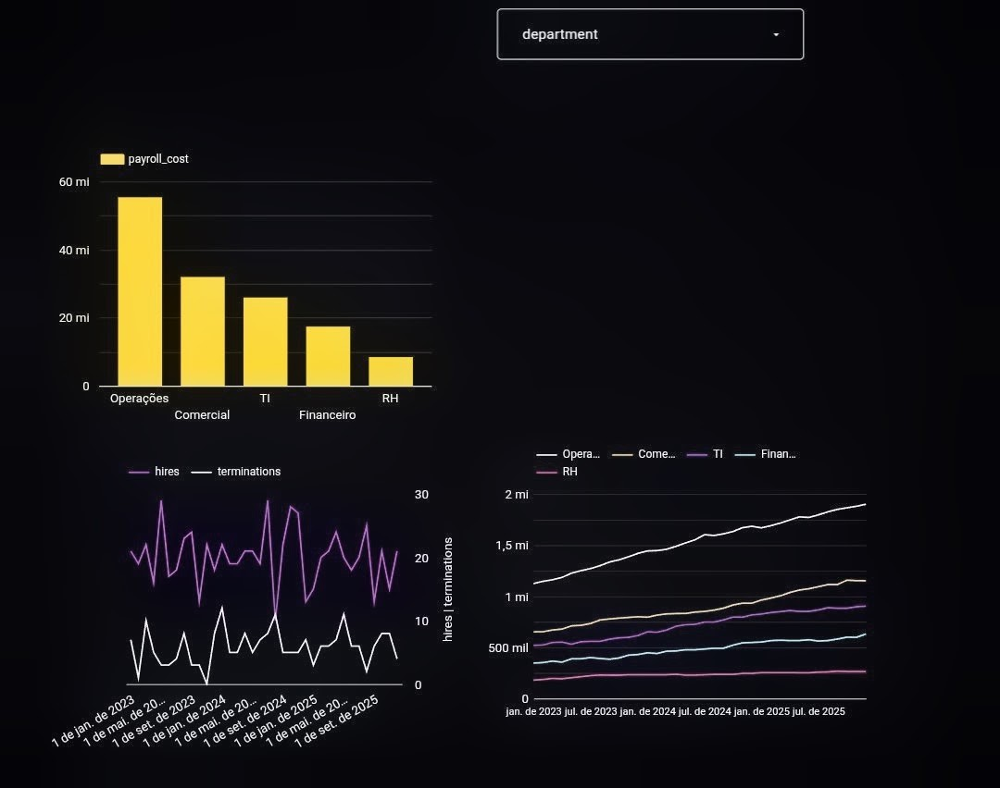

# Análise de Folha de Pagamento de RH | HR Payroll Analysis

[](https://colab.research.google.com/github/klaytonsi/analise-folha-pagamento-rh/blob/main/analise_folha_pagamento.ipynb)

## 📊 Dashboard

[Ver dashboard interativo / View interactive dashboard](https://datastudio.google.com/reporting/54a9496d-e5d4-4412-919c-c336daadaa7a)

[](images/dashboard.jpg)

**PT:** Análise de folha de pagamento de RH com SQL avançado (CTEs, window functions) em dados 100% sintéticos, com DuckDB, Pandas e Plotly.
**EN:** HR payroll analysis with advanced SQL (CTEs, window functions) on 100% synthetic data, using DuckDB, Pandas and Plotly.

## Perguntas respondidas / Questions answered

| # | Pergunta / Question | Técnica SQL |
|---|---|---|
| 1 | Custo mensal de folha por departamento / Monthly payroll cost per department | `LAG`, soma acumulada no ano |
| 2 | Top 3 salários por departamento / Top 3 salaries per department | `DENSE_RANK` |
| 3 | Turnover mensal + média móvel de 3 meses / Monthly turnover + 3-month moving average | CTEs, `AVG() OVER (ROWS BETWEEN ...)` |
| 4 | Funcionários 15%+ acima da média do cargo / Employees 15%+ above their job average | `AVG() OVER (PARTITION BY ...)` |

As consultas também estão isoladas em [`sql/consultas.sql`](sql/consultas.sql). / The queries are also available standalone in `sql/consultas.sql`.

## Como executar / How to run

**No Google Colab (mais fácil) / In Google Colab (easiest)**

1. Clique no botão "Open in Colab" acima / Click the "Open in Colab" badge above
2. Ambiente de execução > Executar tudo / Runtime > Run all
3. Baixe `output/resumo_dashboard.csv` e envie ao Looker Studio (grátis) / Download the CSV and upload it to Looker Studio (free)

**Localmente / Locally**

```bash
git clone https://github.com/klaytonsi/analise-folha-pagamento-rh.git
cd analise-folha-pagamento-rh
pip install -r requirements.txt
jupyter notebook analise_folha_pagamento.ipynb
```

Uma cópia do CSV gerado já está em [`output/resumo_dashboard.csv`](output/resumo_dashboard.csv) (180 linhas: 36 meses × 5 departamentos). / A copy of the generated CSV is already in `output/`.

## Dicionário de dados / Data dictionary

Todos os dados são gerados no notebook (seed fixa). / All data is generated inside the notebook (fixed seed).

| Tabela / Table | Colunas / Columns | Descrição / Description |
|---|---|---|
| `departments` | `department_id`, `department` | 5 departamentos: TI, Financeiro, RH, Comercial, Operações |
| `jobs` | `job_id`, `job_title`, `department_id`, `base_salary` | 10 cargos com salário base em R$ |
| `employees` | `employee_id`, `job_id`, `department_id`, `salary`, `hire_date`, `termination_date` | 1.500 funcionários (apenas IDs numéricos), admissões 2020-2025, ~28% desligados; `termination_date` nula = ativo |
| `payroll` (view) | `month_start`, `employee_id`, `department_id`, `salary` | Uma linha por funcionário por mês ativo (2023-2025) |
| `resumo_dashboard.csv` | `month_start`, `department`, `headcount`, `payroll_cost`, `hires`, `terminations` | Mês × departamento, usado no Looker Studio |

## Principais resultados / Key results

| Indicador / Metric | Valor / Value |
|---|---|
| Folha mensal jan/23 → dez/25 / Monthly payroll | R$ 2,82 mi → R$ 4,85 mi (+72%) |
| Headcount jan/23 → dez/25 | 647 → 1.144 (+77%) |
| Custo anual / Annual cost | R$ 37,8 mi (2023), R$ 46,5 mi (2024), R$ 54,8 mi (2025) |
| Turnover anual / Annual turnover | 7,5% (2023), 9,1% (2024), 6,8% (2025) |
| Ativos 15%+ acima da média do cargo / Active outliers | 124 de 1.140 (10,9%), ~R$ 115 mil/mês de excedente |

## Conclusões de negócio / Business conclusions

1. **PT:** o custo cresce com o headcount, não com salário: a folha subiu 72% enquanto o custo médio por pessoa ficou estável (R$ 4.357 → R$ 4.238). **EN:** payroll growth is driven by hiring, not raises.
2. **PT:** Operações é 39,2% da folha (dez/25); TI é o mais caro por pessoa (R$ 6.313) e Financeiro cresceu mais rápido (+82,1%). **EN:** Operations is the largest cost; TI is the most expensive per head.
3. **PT:** turnover baixo e estável (média mensal de 0,66%), com picos em mar/23 (1,47%) e jan/24 (1,44%). **EN:** low, stable turnover with two spikes.
4. **PT:** 10,9% dos ativos ganham 15%+ acima da média do cargo; 13 dos 15 maiores salários por departamento estão nesse grupo, o que aponta para revisar faixas salariais dentro de cada cargo. **EN:** about one in ten active employees is a pay outlier; review pay bands within jobs.

Detalhes e números por departamento na seção 8 do notebook. / Full detail in section 8 of the notebook.

## Limitações e próximos passos / Limitations and next steps

- **Dados sintéticos:** admissões uniformes no tempo e salários sem reajuste, então o custo por pessoa não muda com o tempo. / Synthetic data: uniform hiring and no salary raises.
- **Próximos passos:** adicionar reajuste anual e encargos (INSS, FGTS, 13º, férias) ao custo; calcular turnover por cargo e por tempo de casa; testes automáticos para as consultas. / Next: annual raises, payroll charges, turnover by job and tenure, automated query tests.

## Estrutura do repositório / Repository structure

```
├── analise_folha_pagamento.ipynb   # notebook principal / main notebook
├── sql/consultas.sql               # consultas SQL isoladas / standalone queries
├── output/resumo_dashboard.csv     # dados do dashboard / dashboard data
├── images/dashboard.jpg            # print do dashboard / dashboard screenshot
├── requirements.txt
├── LICENSE
└── README.md
```

## Stack

Python, SQL, DuckDB, Pandas, Plotly, Google Colab, Looker Studio

## Reprodutibilidade / Reproducibility

Seed fixa (`SEED = 42`): mesmos dados e resultados a cada execução. / Fixed seed: same data and results on every run.

## Segurança / Security

- Somente dados sintéticos: sem nomes, CPF, e-mails ou salários reais / Synthetic data only
- Sem chaves, tokens ou conexões externas / No API keys, tokens or external connections
- Banco em memória, nada sensível é armazenado / In-memory database, nothing sensitive stored

## Licença / License

MIT
